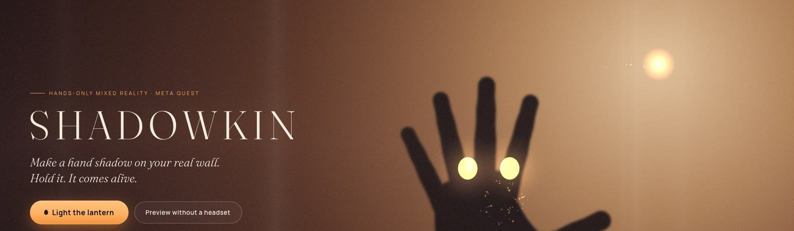
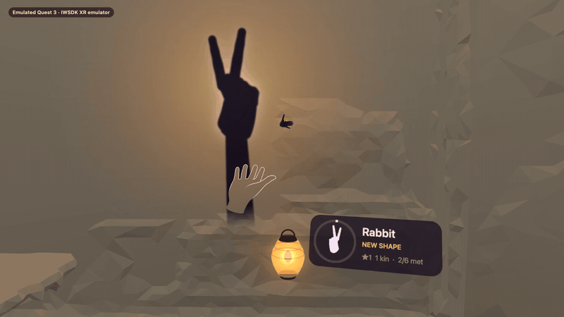
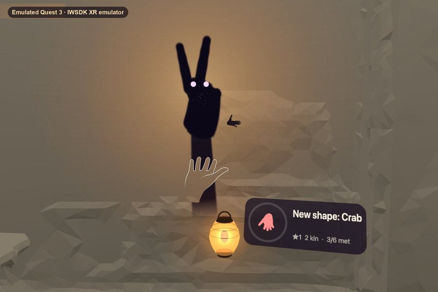
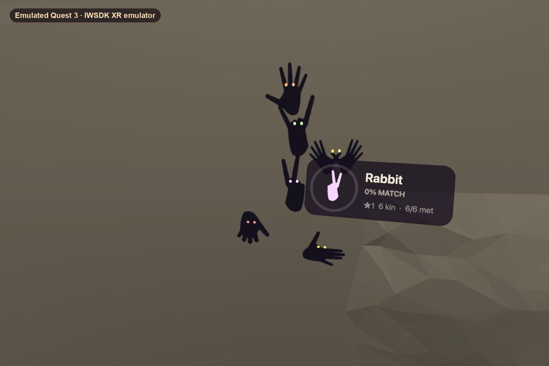
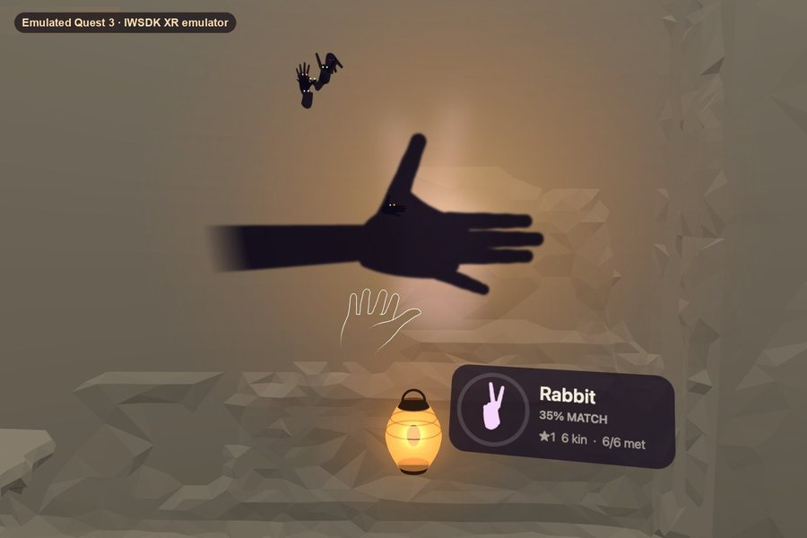
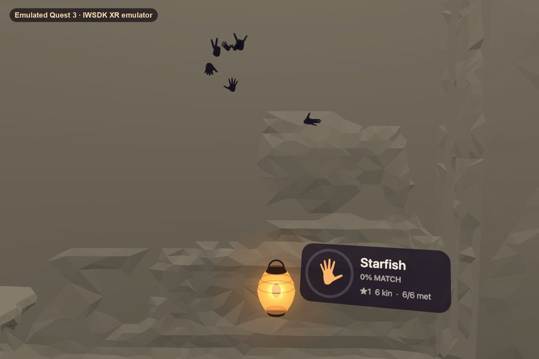
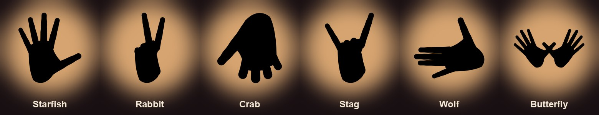
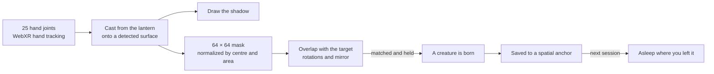
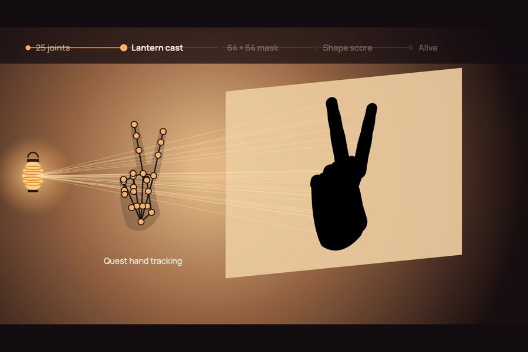
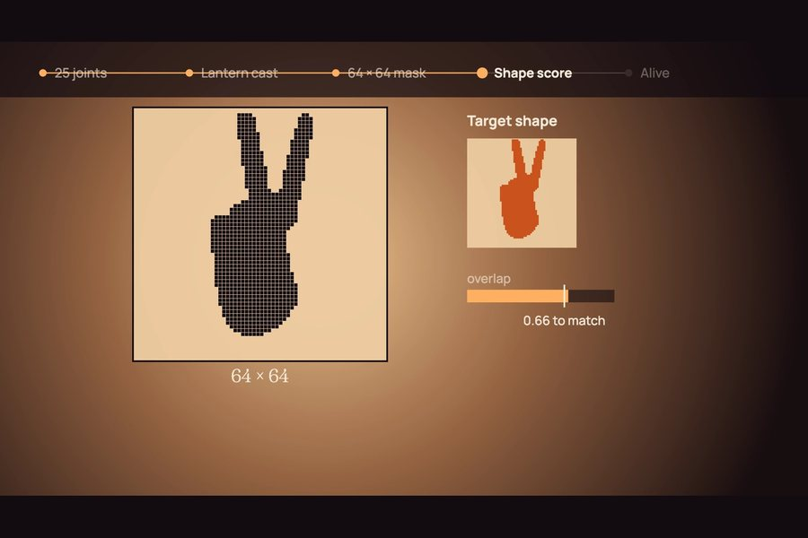

<p align="center">
  <a href="https://shadowkin.vercel.app"></a>
</p>

<h1 align="center">Shadowkin</h1>

<p align="center">
  <b>Make a hand shadow on your real wall. Hold it. It comes alive.</b><br>
  A seated, hands-only mixed reality game for Meta Quest 3 and 3S.
</p>

<p align="center">
  <a href="https://shadowkin.vercel.app"></a>
  <a href="https://youtu.be/MZuxKrEJJU8"></a>
</p>

<p align="center">
  
  
  
  
  
  
</p>

<p align="center">
  <a href="#play-it">Play</a> ·
  <a href="#how-a-session-goes">How it plays</a> ·
  <a href="#the-kin">The kin</a> ·
  <a href="#how-it-works">How it works</a> ·
  <a href="#run-it-locally">Run it locally</a> ·
  <a href="#code-map">Code map</a> ·
  <a href="#status">Status</a>
</p>

<p align="center">
  <br>
  <sub>Recorded in the IWSDK XR emulator on an emulated Quest 3.</sub>
</p>

Every kid has made a shadow rabbit on a wall, and it always vanished when the light went out. Shadowkin gives the shadow what it never had: a life of its own, in your room, waiting for you tomorrow.

## Play it

- **On a Quest 3 or 3S:** open **[shadowkin.vercel.app](https://shadowkin.vercel.app)** in the Quest Browser, tap *Light the lantern*, and put the controllers down.
- **On a computer:** open the same link and choose the desktop preview. The mouse moves a simulated hand.

## How a session goes

<table>
  <tr>
    <td width="50%"></td>
    <td width="50%"></td>
  </tr>
  <tr>
    <td><b>1. Cast and match.</b> Raise a hand and its shadow lands on your wall. Bend your fingers until it fills the glowing shape, then hold it.</td>
    <td><b>2. It comes alive.</b> The shadow peels off the wall as a creature with glowing eyes.</td>
  </tr>
  <tr>
    <td></td>
    <td></td>
  </tr>
  <tr>
    <td><b>3. Play with your hands.</b> Poke one and it spins. Sweep your shadow and they scatter. Hold still and they creep closer. Make a wolf and everyone panics, except your wolves.</td>
    <td><b>4. Come back.</b> Your kin are asleep where you left them, and they wake when they see your hands. Today's shadow keeps your ★ streak going.</td>
  </tr>
</table>

## The kin

<p align="center">
  
</p>

Each kin is the real shadow of a hand pose, and each one unlocks the next. The Butterfly takes both hands.

| Gesture | What happens |
|---|---|
| Raise a hand between the lantern and a wall | Your joints cast a real shadow; distance sets its size and softness |
| Fill the glowing shape and hold | The shadow comes alive |
| Touch a creature with your index fingertip | It spins |
| Sweep your shadow, or hold it still | They scatter, or creep closer |
| Make a wolf shadow | Everyone panics; your wolves come and howl |
| Pinch the lantern | Move it |
| Turn a palm up | Opens *Skip*, *Easy* and *Sound*; poke them with your other index finger |

## How it works



<table>
  <tr>
    <td width="50%"></td>
    <td width="50%"></td>
  </tr>
  <tr>
    <td><b>Real light logic.</b> Move your hand toward the lantern and the shadow grows and softens, because the joints are projected from a point light.</td>
    <td><b>Scored as a shape.</b> Normalizing what is actually drawn means hand size, distance and left or right hand don't matter.</td>
  </tr>
</table>

- **Passthrough matters:** shadows land on surfaces found by plane detection, so your room is the stage.
- **No art files:** creatures are drawn from hand poses, and all sound is synthesized live.
- **No external services:** no AI, no API and no backend. Saves live in local storage and spatial anchors.
- **Built for seated play:** everything stays within arm's reach, and you don't need to read anything.

## Run it locally

Requires Node.js (see `.nvmrc`).

```sh
npm install
npm run dev        # dev server and a browser with the IWER Quest 3 emulator
npm run typecheck
npm run build      # outputs to dist/
```

<details>
<summary><b>Desktop preview controls</b></summary>

Choose the desktop preview on the landing page.

| Input | Action |
|---|---|
| Mouse | Move the simulated hand |
| `1`–`6` | Starfish, Rabbit, Crab, Stag, Wolf, two-handed Butterfly |
| `0` | Open hand |
| `n` | Skip |
| `e` | Toggle Easy |
| `m` | Toggle sound |

</details>

<details>
<summary><b>Automated checks</b></summary>

Start the server with `npx @iwsdk/cli dev restart --allow-browser-automation`, then:

```sh
npx @iwsdk/cli browser run scripts/desktop-check.mjs --timeout 105000   # full loop, persistence, reactions
npx @iwsdk/cli xr enter && npx @iwsdk/cli xr set-input-mode --input-json '{"mode":"hand"}'
npx @iwsdk/cli browser run scripts/xr-state.mjs                         # app state in the emulated XR session
```

`window.__shadowkin` exposes `state()`, `selfTest()` (cross-scores between all targets), `save()`, `wipe()` and `reset()`.

</details>

<details>
<summary><b>Deploy</b></summary>

`vercel.json` builds with `npm run build` and serves `dist/`.

```sh
npx vercel@latest deploy --prod
```

</details>

## Code map

| File | What it does |
|---|---|
| [`src/shadow-system.ts`](src/shadow-system.ts) | Core loop: hands, surface pick, projection, scoring, birth; lantern, anchor, HUD, saving |
| [`src/creature-system.ts`](src/creature-system.ts) | Creature life: wander, pet, flee or follow, wolf panic, sleep and wake, voices |
| [`src/shadow-projector.ts`](src/shadow-projector.ts) | Surfaces from XR planes, point-light projection, shadow drawing |
| [`src/matcher.ts`](src/matcher.ts) | 64×64 raster, normalization, overlap over rotations and mirror |
| [`src/silhouettes.ts`](src/silhouettes.ts) | Target shapes as poses of a parametric hand |
| [`src/hand-skeleton.ts`](src/hand-skeleton.ts) | WebXR joint layout and the parametric hand model |
| [`src/save.ts`](src/save.ts) | Save data, daily shape, streak, unlocks |
| [`src/audio.ts`](src/audio.ts) | Synthesized lantern crackle, match hum, spatial creature voices |
| [`src/palm-menu.ts`](src/palm-menu.ts) | Palm-up, hands-only settings |
| [`src/lantern.ts`](src/lantern.ts), [`src/creature-art.ts`](src/creature-art.ts), [`src/fx.ts`](src/fx.ts) | Procedural art and particles |

## Status

Built for the [Meta VR Start Developer Competition 2026](https://start-developer-competition-26.devpost.com/) (Gaming, New Experience).

- [x] Full game loop, daily shadow, kin and persistence, tested in the IWSDK XR emulator
- [ ] Test on real Quest 3 and 3S headsets in several rooms
- [ ] Tune shapes against real hands
- [ ] Make tables a full stage alongside walls

Submission notes and the on-device checklist are in [SUBMISSION.md](SUBMISSION.md).

<p align="right"><a href="#shadowkin">Back to top ↑</a></p>
